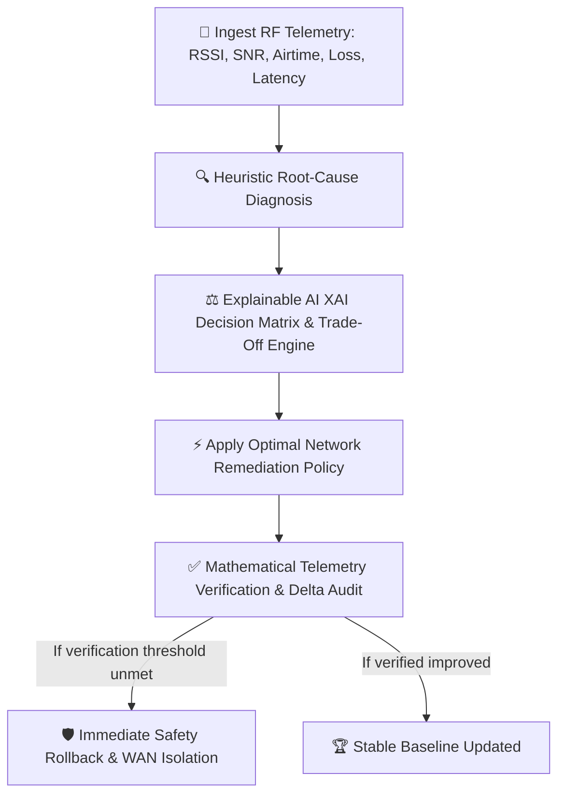

# WiFiMind — Autonomous Wi-Fi Recovery & Self-Healing Engine 🧠📶

> **Closed-Loop Autonomic Networking System**: *DIAGNOSE → DECIDE → APPLY → VERIFY*

WiFiMind is an interactive, autonomous network recovery system designed to continuously diagnose Wi-Fi degradation, evaluate multi-factor recovery policies using Explainable AI (XAI), simulate network remediations, and mathematically verify performance gains with automated safety rollbacks.

Live Demo: **[https://wifi-ax4ptrhyn-likhithchowdarynuvvula22-7994s-projects.vercel.app](https://wifi-ax4ptrhyn-likhithchowdarynuvvula22-7994s-projects.vercel.app)**

---

## 💡 Innovation & Novel Concept

### 1. Closed-Loop Autonomic Control Architecture
Traditional network troubleshooting is reactive, manual, and cryptic. WiFiMind implements the **MAPE-K (Monitor, Analyze, Plan, Execute, Knowledge)** autonomic loop:



### 2. Explainable AI (XAI) Decision Matrix
Unlike black-box models, WiFiMind features an **XAI Multi-Factor Utility Function** that transparently calculates and ranks every candidate recovery policy before taking action:

$$\text{Utility}(Action) = 0.40 \cdot \Delta\text{Throughput} + 0.35 \cdot \Delta\text{Latency} - 0.15 \cdot \text{DisruptionRisk} + 0.10 \cdot \text{SNR}$$

- **Policy Ranking**: Compares the top recommendation against rejected alternatives (e.g., explaining why channel hopping is rejected if adjacent bands suffer co-channel overlap).
- **Safety Verification Guard**: Guarantees zero false-positive Wi-Fi reconfigurations when root-cause telemetry indicates an upstream ISP/WAN outage.

### 3. Continuous "Auto-Pilot" Self-Healing
Enable the **Auto-Pilot** toggle in the dashboard header to activate continuous autonomous operation. WiFiMind constantly monitors network health, immediately detects degradation, triggers smart diagnosis, applies recovery actions, and verifies the resolution without human intervention.

---

## 🧪 Comprehensive Automated Testing & Verification

WiFiMind includes a test suite covering unit heuristics, closed-loop integration, and mathematical RF physics.

### Running Automated Tests via CLI
Execute all 13 test suites with sub-second execution using [Vitest](https://vitest.dev/):

```bash
npm test
```

```text
 ✓ src/engine/__tests__/diagnostics.test.ts (13 tests) 8ms
 Test Files  1 passed (1)
      Tests  13 passed (13)
```

### In-App Interactive Test Runner & Benchmark
Judges and evaluators can inspect and trigger test suites directly inside the application:
1. Open the **"System Verification"** tab in the sidebar.
2. Click **"Re-Run All Tests"** to watch live in-browser execution with real-time assertions and millisecond duration benchmarks.
3. Test suites verified:
   - **Diagnostic Engine Classification**: Verifies root causes for all 4 scenarios with confidence $\ge 70\%$.
   - **Closed-Loop Verification**: Validates deterministic metric improvements and follow-up guidance.
   - **RF Physics Invariants**: Proves capacity conservation (QoS redistributes airtime without phantom bandwidth) and 2D free-space path loss equations.
   - **Safety Rollback Integrity**: Verifies state restoration and zero false-positive WAN isolation.
4. **Interactive Fault & Chaos Injection Sandbox**: Click **"Inject RF Burst Noise"** or **"Inject Airtime Jitter"** to test live engine resilience.
5. **Export Audit Report**: Download a JSON report of all test assertions with a cryptographic timestamp.

---

## 🛠️ Built-in Failure Scenarios

| Scenario | Root Cause | Baseline Symptoms | Applied Autonomous Policy | Outcome |
| :--- | :--- | :--- | :--- | :--- |
| **Scenario A** | **2.4 GHz Channel Congestion** | Latency 145ms, 88% airtime utilization | Non-overlapping channel switch (Ch 6/11) + 5 GHz band steering | **Improved**: Latency $\rightarrow$ 38ms, Ch Util $\rightarrow$ 41% |
| **Scenario B** | **Weak Signal & Path Loss** | Throughput 8 Mbps, 6.1% packet loss | Centralized AP repositioning + Mesh Node expansion | **Partially Improved**: Residual kitchen dead-zone flagged |
| **Scenario C** | **Bandwidth Monopolization** | 1 Device eating 77% capacity, latency 95ms | QoS Priority Scheduling (Critical Work, Low Background) | **Improved**: Latency $\rightarrow$ 22ms, Fair-share restored |
| **Scenario D** | **Upstream ISP Gateway Failure** | 100% WAN drop, Local Wi-Fi healthy | **Safety Lock**: Do NOT modify local RF; isolate modem/ISP link | **Not Improved (Protected)**: Prevents destructive RF churn |

---

## 💻 Tech Stack & Architecture

- **Frontend & UI**: React 19, TypeScript, Pure Modern CSS (Glassmorphism & Cyberpunk Dashboard Aesthetics)
- **Icons**: Lucide React
- **Build Engine**: Vite 8
- **Testing Framework**: Vitest (CLI runner + Custom in-browser test harness)
- **Deployment**: Vercel Global Edge CDN

---

## 🏁 Getting Started

### Prerequisites
- Node.js 18+ & npm 9+

### Installation & Run
```bash
# Clone the repository
git clone https://github.com/likhithchowdarynuvvula22-hash/wifi.git
cd wifi

# Install dependencies
npm install

# Run automated tests
npm test

# Start local development server
npm run dev
```

Visit `http://localhost:5173` in your browser.

### Production Build
```bash
npm run build
```
Builds statically to `dist/` with full TypeScript type-checking.

---

## 📂 Project Organization

```text
├── src/
│   ├── components/
│   │   ├── Overview.tsx         # Real-time health metrics, scenario switcher, & network telemetry
│   │   ├── Diagnosis.tsx        # Smart Diagnosis, Explainable AI (XAI) Matrix, & Apply Simulation
│   │   ├── Devices.tsx          # Connected client inventory, Band Steering, & QoS prioritization
│   │   ├── Heatmap.tsx          # 2D Euclidean floor plan with signal attenuation physics
│   │   ├── ActionHistory.tsx    # Chronological audit log with Before vs After metric deltas
│   │   ├── TestRunner.tsx       # In-App Automated Test Runner, Chaos Sandbox, & JSON Exporter
│   │   └── Sidebar.tsx          # Navigation sidebar with status badges
│   ├── engine/
│   │   ├── diagnostics.ts       # Closed-loop decision heuristics & RF mathematical models
│   │   ├── testRunner.ts        # In-browser deterministic test harness and assertion runner
│   │   └── __tests__/
│   │       └── diagnostics.test.ts # Vitest automated test suite (13 unit/integration tests)
│   ├── data/
│   │   └── mockData.ts          # Baseline topology, device profiles, & scenario metrics
│   ├── types/
│   │   └── index.ts             # Strict TypeScript definitions
│   ├── App.tsx                  # Root state coordinator & Auto-Pilot autonomous agent
│   ├── index.css                # Global design system & theme variables
│   └── main.tsx                 # Application entry point
├── package.json                 # Scripts and dependencies
├── vercel.json                  # SPA routing configuration for Vercel
└── vite.config.ts               # Vite bundler configuration
```
