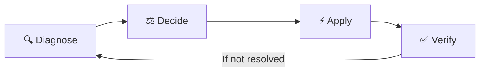

# WiFiMind — Intelligent Wi-Fi Recovery 🧠📶

> **Autonomous Self-Healing Wi-Fi Engine**: *Diagnose → Decide → Apply → Verify*

WiFiMind is a responsive, interactive web application and prototype AI decision-system designed to autonomously identify poor Wi-Fi performance, prescribe optimal corrective actions, execute simulated remediations, and verify measurable network improvements.

---

## 🚀 Key Highlights & Philosophy

Traditional Wi-Fi troubleshooting is reactive, manual, and cryptic for ordinary users. WiFiMind introduces a closed-loop autonomic networking model:



1. **Diagnose**: Ingests real-time RF telemetry (RSSI, SNR, channel utilization, packet loss, DNS latency, airtime distribution).
2. **Decide**: Matches symptoms against diagnostic heuristics, ranking recovery actions with confidence scores and anticipated impact.
3. **Apply**: Simulates corrective network changes (dynamic channel/DFS switching, 5GHz/6GHz band steering, QoS bandwidth throttling, Tx power boost).
4. **Verify**: Measures post-action telemetry against baseline metrics and determines recovery success with full rollback support.

---

## 🛠️ Built-in Scenarios

WiFiMind comes pre-loaded with realistic Wi-Fi degradation scenarios for live demonstration:

| Scenario | Root Cause | Primary Symptom | Automated Recommendation |
| :--- | :--- | :--- | :--- |
| **Scenario A** | **2.4 GHz Congestion & Co-Channel Interference** | High latency (85ms), 88% airtime utilization | Switch to DFS 5 GHz Channel 149 & steer high-traffic devices |
| **Scenario B** | **Bandwidth Hogging & Airtime Starvation** | Video calls dropping, heavy background torrent/download | Enforce QoS throttling on hogging device (cap to 15 Mbps) |
| **Scenario C** | **Dead Zone & Weak Signal Penetration** | Low RSSI (-78 dBm) in Bedroom/Patio | Boost Tx power to +22 dBm & activate Mesh Node steering |
| **Scenario D** | **Upstream ISP / DNS Resolution Bottleneck** | High DNS lookup latency (420ms), RF metrics normal | Migrate Primary Gateway DNS to Cloudflare (1.1.1.1) |

---

## 📱 Interactive Modules

- **📊 Network Overview**: Real-time health score, signal quality, active scenario switcher, and quick-status metrics.
- **🔬 Smart Diagnosis**: Deep telemetry inspector, root-cause diagnosis engine, recommended action breakdown, and one-click **"Apply Action"** simulation.
- **📶 Interactive Coverage Heatmap**: Visual floor plan (Living Room, Office, Bedroom, Kitchen, Patio) with live RSSI signal strength, throughput ratings, and Access Point placement.
- **💻 Connected Devices**: Granular device inventory (Laptops, Smart TVs, Phones, IoT) displaying MAC addresses, band allocations, real-time consumption, and QoS priorities.
- **📜 Action History & Audit Log**: Chronological log of applied remediations, outcome verification (Before vs After comparisons), and one-click **Rollback** functionality.

---

## 💻 Tech Stack

- **Framework**: [React 18](https://react.dev/) + [TypeScript](https://www.typescriptlang.org/)
- **Build Tool**: [Vite](https://vitejs.dev/)
- **Icons**: [Lucide React](https://lucide.dev/)
- **Styling**: Vanilla CSS Design System with dark glassmorphism, fluid typography, and micro-animations.

---

## 🏁 Getting Started

### Prerequisites
- [Node.js](https://nodejs.org/) (version 18.0.0 or higher recommended)
- [npm](https://www.npmjs.com/) (version 9 or higher)

### Installation

1. Clone or navigate to the project directory:
   ```bash
   cd c:\hackthon
   ```

2. Install dependencies:
   ```bash
   npm install
   ```

### Running Locally

Start the local development server:
```bash
npm run dev
```

Open your browser and navigate to:
```
http://localhost:5173
```

### Production Build

To build the static production bundle:
```bash
npm run build
```

To preview the production build locally:
```bash
npm run preview
```

---

## 📂 Project Structure

```text
├── src/
│   ├── components/
│   │   ├── Overview.tsx         # Dashboard overview, health metric cards, and scenario selector
│   │   ├── Diagnosis.tsx        # Telemetry inspection, AI recommendations, and apply simulation
│   │   ├── Heatmap.tsx          # Floor plan coverage map with room-by-room RF visualization
│   │   ├── Devices.tsx          # Client device management, bandwidth consumption, and QoS tags
│   │   ├── ActionHistory.tsx    # Verification results, audit log, and rollback triggers
│   │   └── Sidebar.tsx          # Navigation sidebar with status badges
│   ├── engine/
│   │   └── diagnostics.ts       # Core heuristic decision engine and scenario generator
│   ├── data/
│   │   └── mockData.ts          # Baseline network topology and default states
│   ├── types/
│   │   └── index.ts             # TypeScript definitions for metrics, scenarios, and actions
│   ├── App.tsx                  # Root state coordinator and application shell
│   ├── index.css                # Global design system, CSS variables, and layout styles
│   └── main.tsx                 # Application entry point
├── public/                      # Static assets and icons
├── package.json                 # Dependencies and build scripts
└── vite.config.ts               # Vite configuration
```

---

## 🏆 Hackathon Notes

- **Unified Single Source of Truth**: All tabs react instantaneously to scenario switches and applied actions.
- **Realistic Verification**: Applying an action updates device states, improves the health score, clears congestion warnings, and creates an audit record with before/after metric deltas.
- **Safety First**: Every automated action supports one-click rollback if real-world verification thresholds are not met.
